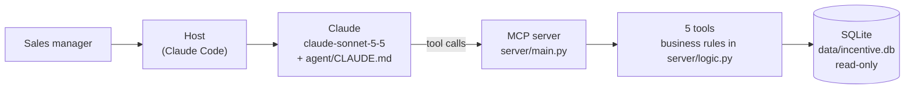

# Incentive Coach

An AI agent that tells a field sales manager which reps to call at month-end, and drafts an honest, number-backed nudge for every rep.

## In 30 seconds

**The problem.** Field sales managers run month-end pushes by WhatsApp and phone across up to 50 reps. Their messages are generic and easy to ignore. Managers can't easily see who is close to an incentive step, who will cross anyway, or what a push is worth, so calls go to the wrong reps.

**What the agent does.**
- **Who to call, and why:** it ranks the reps a call can still help, and shows the numbers behind each rank.
- **A nudge for every rep:** each message has that rep's own gap, the payout it unlocks, and the daily pace needed.
- **Drafts only:** the manager reviews and sends every message. The agent never sends anything.

**What's been tested** (from [docs/EVALS.md](docs/EVALS.md)):

| Test | Result |
|---|---|
| Unit tests | 32/32 |
| Agent evals, dev set, before fixes (re-scored with final checks) | 31/33 |
| Agent evals, held-out set, before fixes (re-scored) | 6/9 |
| Agent evals, dev set, after fixes (3 runs per case) | 33/33 |
| Agent evals, held-out set, after fixes (3 runs per case) | 12/12 |
| Judge canaries (bad answers the judge must fail) | 4/4 caught |
| Human agreement with the judge | 10/10 |

The evals caught two false passes in the first runs; see [docs/EVALS.md](docs/EVALS.md).

These test that the agent follows its rules on synthetic data. Whether nudges lift sales needs a live experiment; see [docs/EXPERIMENT.md](docs/EXPERIMENT.md).

All data is synthetic.

## Example

A real question and answer from `evals/results/2026-10-25_183727.json` (case 1, run 1). The agent was `claude-sonnet-5-5` with the prompt in `agent/CLAUDE.md`. The answer is shortened: `[…]` marks cuts, and the table keeps 6 of its 11 columns.

**Manager:** Who should I call today?

**Agent** (1 tool call: `get_team_status`):

> Today is day 24 of 30, so there are 6 days left. Fifteen reps are in reach. These are the first five to call, in order:
>
> | Rank | Rep | Gap | Pace multiple needed | Incentive unlocked | Priority |
> |---|---|---|---|---|---|
> | 1 | Akash (R03) | ₹18,120 | 1.27x | ₹1,500 | 3.51 |
> | 2 | Hema (R44) | ₹17,840 | 1.25x | ₹1,500 | 3.49 |
> | 3 | Suresh (R32) | ₹17,310 | 1.2x | ₹1,500 | 3.34 |
> | […] | | | | | |
>
> **How the ranking works:** priority is the margin if the rep crosses, divided by the incentive unlocked. A higher number means call first. The five reps above are all heading for the ₹75,000 step. That step unlocks only ₹1,500 each, so their margin per rupee of incentive is high.
>
> […]
>
> **Flag for you (not for the rep):** Vidya (R37, rank 11) is a late starter. She began on day 10, so her pace of ₹2,219 a day is averaged over 15 days, not 24.
>
> I can draft nudges for this group or pull up the detail on any one rep.

## How it works



**The model decides, code calculates.**
- The model chooses which tools to call, explains the results and writes the words of each message.
- Code works out every number: segments, gaps, paces, payouts, rankings and totals. It also fills those numbers into the messages.
- The model is told never to do arithmetic. Eval code checks compare the payouts, counts, totals and pace multiples it quotes with the tools' numbers.

## Tools

From [docs/TOOLS.md](docs/TOOLS.md). Every tool reads the database read-only and returns structured JSON, not prose.

| Tool | What it answers | One design choice |
|---|---|---|
| `get_team_status` | Where does the team stand, and who should I call? | Flags are included for every rep, so a call list takes 1 tool call instead of 16 |
| `get_rep_detail` | Everything about one rep, plus notes for the manager | Bulk orders are detected from the data, and the tool shows which segment the rep would be in without them |
| `calculate_payout` | What does a rep earn now, and after some extra sales? | "Now" and "after" are side by side, with the step payout and focus-piece kicker split out |
| `fill_nudges` | One finished message per rep, from one template per segment | The model writes `{placeholders}` and code fills in the numbers. An unknown placeholder is an error, not a blank |
| `get_payout_totals` | What does the whole team, or a segment, cost now and if every in-reach rep crosses? | Totals come from code, so the agent never adds up per-rep figures itself |

## Evaluation

- **Method:**
  - 15 cases: 11 dev and 4 held-out, each run 3 times.
  - Code checks wherever there's a right answer: tools called, rupee figures, counts, pace multiples.
  - A judge model (`claude-opus-5-5`) for behaviour rules: no predictions, no stock loading, drafts only, saying when the tools can't answer.
- **Two false passes found:**
  - The agent worked out pace ratios itself and got them wrong ("3 to 5 times" when the real range was 2.27 to 7.86).
  - A payout-total case passed while the agent either declined or added up 15 payouts itself.
  - In both cases the fix went into the tools (`pace_multiple_needed`, `get_payout_totals`), not the prompt.
- **Before and after, all scored with the final checks:**
  - Before: dev 31/33, held-out 6/9. All 3 held-out failures are the payout-total case, whose check now requires a tool that didn't exist yet.
  - After: dev 33/33, held-out 12/12.
- **Judge trust:**
  - 4/4 canaries caught, and 10/10 human agreement.
  - Both test leniency (false passes) only. Harshness is untested.

Full method, case list, ablation and limitations: [docs/EVALS.md](docs/EVALS.md).

## Key decisions

More in [docs/PRD.md](docs/PRD.md).

| Decision | Choice | Reason |
|---|---|---|
| Who sends | The agent drafts; the manager sends | One payout error sent to 50 reps destroys trust. A person checks every number until evals prove accuracy |
| Message numbers | The model writes a template; code fills in each rep's numbers | Every rupee figure matches tool output by construction, not by checking afterwards |
| Segments and calls | Four segments by projected month-end. Only in-reach reps are ranked for a call, by margin gained ÷ incentive unlocked | On-track reps should cross anyway, and far-behind reps need more than 1.5× their pace. A call is worth most to in-reach reps |
| North star | Incremental gross margin per incentive rupee, net of next-month returns, vs generic reminders | It measures what the buyer pays for, and the returns adjustment catches stock loading. A positive net sales lift is the floor |
| Model | `claude-sonnet-5-5` ships; the Day 3 exploration used Opus in Claude Code | The model the evals measure is the model that ships |

## Limitations

- **The ranking ignores difficulty within in-reach.** Call priority uses margin and incentive, not how big a jump in pace the rep needs.
- **Step-1 reps always rank last.** Crossing step 1 also unlocks the kicker on all focus pieces, so the incentive is larger and the ratio smaller.
- **Templates can't adapt to per-rep flags.** There is one template per segment. A flag, such as a bulk order inflating a rep's pace, reaches the manager as a note but can't change that rep's message.
- **Synthetic data:** 50 made-up reps on day 24 of 30.
- **Small eval samples:** 3 runs per case. 3/3 shows something works, not how reliably.
- **Held-out cases were written by the same coding agent** that built the tools and prompt.
- **Judge harshness is untested.** Nothing checks for good answers being judged as failing.

## Beyond field sales

The same pattern fits any frontline team that is paid against targets and nudged by a manager. Code computes each person's numbers, the model writes the wording, and a person sends it.
- **Retail store associates:** sales against daily or weekly targets, with add-on items in place of focus products.
- **Field service technicians:** jobs completed, first-time-fix rate or upsell attachment against monthly incentive tiers.

## Run it yourself

You need [uv](https://docs.astral.sh/uv/) and Python 3.12 or later.

```bash
git clone <this repo> incentive-coach
cd incentive-coach
uv sync                                   # install dependencies

uv run pytest                             # 32 unit tests, no API calls
uv run python data/check.py               # segment mix of the synthetic data
uv run python evals/run.py --dry-run      # checks eval cases and tools, no API calls
uv run python evals/rescore.py evals/results/2026-10-25_183727.json   # re-score a saved run, no API calls
```

Real eval runs call the API and cost money. They need your own key in a `.env` file in the project folder, which is git-ignored:

```bash
echo "ANTHROPIC_API_KEY=your-key" > .env
uv run python evals/run.py --set dev      # 11 cases x 3 runs (paid)
```

To use the agent in [Claude Code](https://claude.com/claude-code), connect the MCP server from the project folder:

```bash
claude mcp add incentive-coach -- uv --directory "$(pwd)" run python server/main.py
claude mcp get incentive-coach            # should show: Status: ✔ Connected
```

Then start `claude` and ask, for example, "Who should I call today?". The agent rules are in `agent/CLAUDE.md`.

## Repo map

| Path | What it is |
|---|---|
| `server/logic.py` | Every business rule: segments, payouts, totals, bulk-order detection |
| `server/main.py` | The MCP server and its 5 tools |
| `agent/CLAUDE.md` | The agent's system prompt (rules) |
| `agent/CLAUDE_minimal.md` | One-line prompt for the ablation |
| `data/` | `generate.py` builds the synthetic `incentive.db` (fixed seed); `check.py` prints its segment mix |
| `tests/` | Unit tests for the business rules and for the eval's pace-multiplier check |
| `evals/cases.py` | The 15 eval cases and their checks |
| `evals/run.py` | Runs the agent and the judge on the cases and saves results |
| `evals/rescore.py` | Re-scores saved results with the current checks, without API calls |
| `evals/judge_canaries.py` | Bad answers the judge must fail |
| `evals/results/` | Every saved eval run, as JSON |
| `docs/PRD.md` | Problem, users, scheme rules, decisions, metrics |
| `docs/TOOLS.md` | Tool inputs, outputs and design choices |
| `docs/DATA.md` | How the synthetic data is built |
| `docs/EVALS.md` | Eval method, results, ablation, limitations |
| `docs/TRANSCRIPTS.md` | Day 3 exploration transcripts (Opus in Claude Code) |
| `docs/judge_check.md` | The 10-answer human check of the judge |

## How this was built

Built with Claude Code. I made the product decisions, designed the tools and eval cases, and reviewed the results. Claude Code wrote most of the code.
